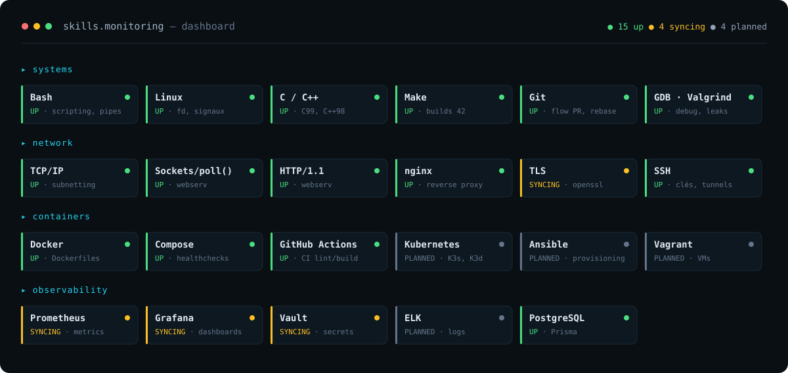

<p align="center">
  
</p>

<p align="center">
  
  
  
  
</p>

```console
$ traceroute ldebarno
 1  42-lausanne         étudiant en tronc commun · Lausanne, CH
 2  layer-4             sockets TCP, I/O non-bloquantes, poll(), HTTP/1.1
 3  layer-7             reverse proxy nginx, TLS, CGI, API REST
 4  ops                 Docker, docker-compose, GitHub Actions, healthchecks
 5  observability       Prometheus · Grafana · Vault (en cours)
 6  next-hop            Kubernetes · Ansible   * * *
```

## ⟶ Projets phares

<table>
<tr>
<td width="50%" valign="top">

### 🛰️ [ft_transcendence](https://github.com/Les-razmokets/42-transcendence)
`DevOps` · `Docker` · `CI/CD` · `nginx`

Application web full-stack conteneurisée — **NestJS · Prisma · PostgreSQL · React/Vite**, servie derrière **nginx en TLS**.

**Mon rôle : DevOps de l'équipe**
- Dockerfiles + `docker-compose` (db, api, front) avec **healthchecks** et `depends_on`
- Pipeline **GitHub Actions** : install, lint, build, logs en cas d'échec
- Génération des **certificats TLS** dans la stack
- Diagrammes d'architecture (actuelle / cible)
- Hot-reload Vite en conteneur pour le dev front

</td>
<td width="50%" valign="top">

### 🌐 [webserv](https://github.com/FiTcHeRs71/WebServ)
`C++98` · `sockets` · `HTTP/1.1` · `CGI`

Serveur HTTP non-bloquant écrit from scratch, configurable à la nginx : virtual servers, autoindex, redirections 301/302, upload POST, 405 + `Allow`, sessions.

**Mon rôle : réseau & CGI**
- **Event loop** sur `poll()` : sockets d'écoute, cycle de vie des connexions
- Branchement du **CGI** sur la boucle : fork/exec, pipes non-bloquants, parsing de la sortie, `502` en cas d'échec
- Fermeture propre des fd côté client et côté CGI

</td>
</tr>
<tr>
<td width="50%" valign="top">

### 🐚 [minishell](https://github.com/Lutchdebarn/minishell)
`C` · `processus` · `fd` · `signaux`

Un shell inspiré de bash : **AST** avec parenthèses, `&&` / `||`, pipes, redirections `< > >> <<`, builtins, gestion des signaux.

</td>
<td width="50%" valign="top">

### 🧵 Autres projets systèmes
- [**pipex**](https://github.com/Lutchdebarn/Pipex) — reproduire `cmd1 | cmd2` avec `pipe`/`dup2`/`fork`
- [**philo**](https://github.com/Lutchdebarn/philo) — threads, mutex, problème des philosophes
- [**push_swap**](https://github.com/Lutchdebarn/push_swap) — tri sous contraintes, complexité
- [**fract-ol**](https://github.com/Lutchdebarn/Fract-ol) — rendu de fractales (MiniLibX)
- [**libft**](https://github.com/Lutchdebarn/libft) — ma lib C de base

</td>
</tr>
</table>

## ⟶ Stack

<p align="center">
  
</p>

<sub>

`assets/skills.svg` est généré par [`scripts/gen-skills.sh`](./scripts/gen-skills.sh) depuis [`skills.conf`](./skills.conf) : une GitHub Action lint le script (shellcheck), régénère le panneau et le commit à chaque modif.
**UP** = maîtrisé · **SYNCING** = en cours d'apprentissage · **PLANNED** = prochaine étape du cursus.

</sub>

## ⟶ Activité

<p align="center">
  
</p>

---

<p align="center">
  <a href="https://profile.intra.42.fr/users/ldebarno"></a>
  <br>
  <sub><code>$ exit 0</code></sub>
</p>
